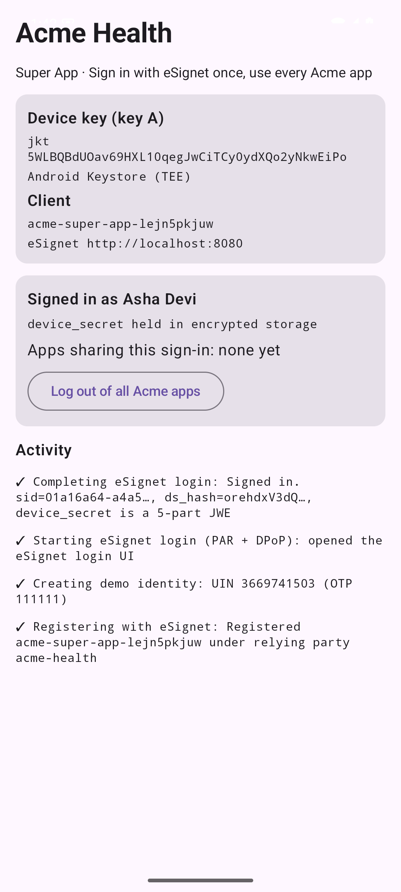
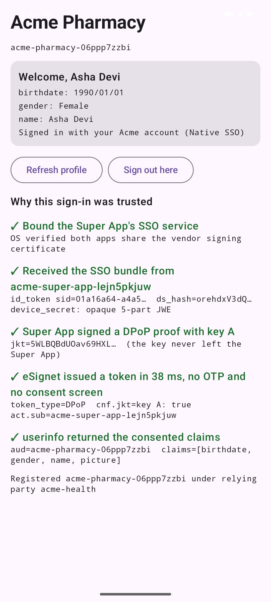
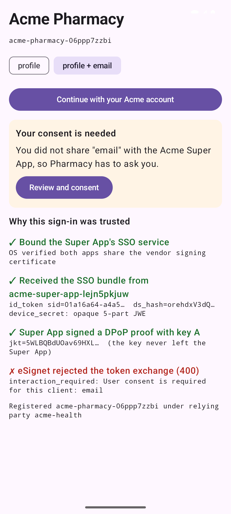
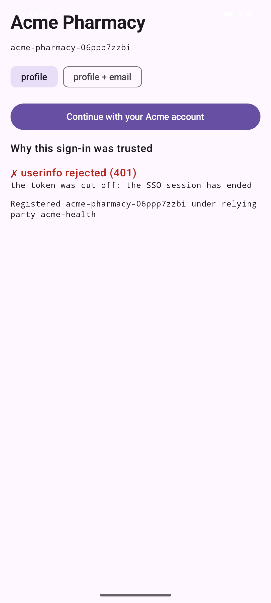
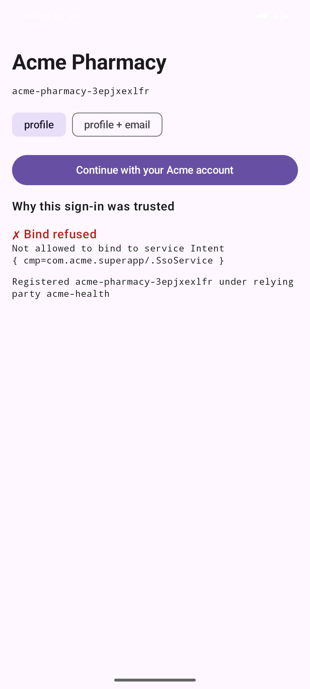
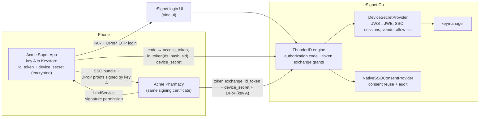

# Native SSO for eSignet Go: sign in once, use every app of the family

[](https://github.com/saisreekantam/mosip-decode-native-sso/actions/workflows/ci.yml)

**MOSIP Decode 2026, problem statement 03: Enable Native SSO in eSignet Go for Mobile Apps.**

**Team TechTitans:** Sai Venkat, Revanth, Aditya, Ashok

A user signs in to one app with eSignet (OTP plus consent). Every other app from the same vendor on that phone then signs them in silently, with no OTP and no consent screen, in about 20 ms. The shared login is protected by:

- a device secret that is bound to the device's own hardware key and encrypted;
- an app-to-app channel that only apps signed by the vendor can use;
- a consent check, so a sibling app gets only the claims the user agreed to share.

The implementation follows OpenID Connect Native SSO for Mobile Apps 1.0 and the eSignet design in the problem statement. It covers all 10 mandatory tasks and the bonus task, plus a set of security hardening features.

| Super App signs in once | Pharmacy app: silent SSO | Consent not covered | Logout cuts off tokens | Rogue app refused |
|---|---|---|---|---|
|  |  |  |  |  |

## What is in this submission

| Part | Where | What it is |
|---|---|---|
| ThunderID engine changes | fork `thunderid`, branch `feature/native-sso` | Protocol: `device_sso` scope, `DeviceSecretProvider`/`NativeSSOConsentProvider` interfaces, `ds_hash` and `sid` in the ID token, `device_secret` in the token response, the device-secret token exchange with every check from the spec, per-app attributes, tokens that end with their session |
| eSignet changes | fork `esignet`, branch `feature/native-sso` | Policy: device secret (signed with ES256, then encrypted as RSA-OAEP JWE through the keymanager), SSO sessions, same-vendor allow-list, consent reuse with an audit column, `POST /native-sso/logout`, config, client registration, DB migration, Postman collection, [design doc](docs/design.md) |
| Android apps | [`native-sso-android/`](native-sso-android) | **Acme Super App** (eSignet login with PAR + DPoP + PKCE, keys in the Android Keystore, signature-protected SSO service) and **Acme Pharmacy** (silent SSO, step-by-step "why trusted" trace, re-consent fallback), plus a rogue build signed with another certificate |
| SSO Guardian test lab | [`native-sso-lab/`](native-sso-lab) | 20 end-to-end scenarios (happy path, attacks, consent, races, logout) against a live eSignet, a dashboard to replay any of them, mutation testing, a Postman runner |
| Docs | [`docs/`](docs) | [Design and API](docs/design.md), [testing and results](docs/testing.md), [demo script](docs/demo-script.md), [submission checklist](docs/submission.md) |

## Architecture



The step-by-step sequence diagrams for both flows are in [docs/design.md](docs/design.md).

## How the requirements map to the code

| # | Problem statement task | Done in |
|---|---|---|
| 1 | `device_sso` scope on the authorize request | ThunderID `granthandlers/native_sso.go` (`splitDeviceSSOScope`), `utils/oauthutils.go` |
| 2 | Token endpoint checks `allowed_authorization_scopes` contains `device_sso` | `validateDeviceSSORequest` |
| 3 | Device Secret Provider interface for ThunderID | `pkg/thunderidengine/providers/interface.go`, `thunderidengine.WithDeviceSecretProvider` |
| 4 | Generate (signed JWT: `cnf.jkt`, `auth_id`, `exp`, `client_id`, `scope`, `acr`, `claims`, `iss`) and Validate | eSignet `internal/engine/device_secret_provider.go` |
| 5 | Token endpoint invokes generation | `issueDeviceSecret` in the authorization code grant |
| 6 | Return `access_token`, `id_token`, `device_secret` (signed then encrypted) | token response `device_secret`; ID token `ds_hash`, `sid` |
| 7 | Second app gets `id_token`, `device_secret` and a DPoP proof app-to-app | Android `SsoService` (Super App) + `SsoConnection` (Pharmacy) |
| 8 | Token exchange call reusing the first app's key, without `device_sso` | `EsignetClient.nativeSsoExchange` |
| 9 | Token exchange grant: device-secret actor type, validate secret, `ds_hash`, `sid`, `device_sso` allowed, `cnf.jkt` = DPoP key | `handleNativeSSOGrant`, `verifyNativeSSOIDToken` |
| 10 | Scope subset rule; reject `device_sso` on token exchange | `nativeSSOScopes`, `validateNativeSSOExchangeRequest` |
| Bonus | Re-consent screen in the second app when scopes differ | `interaction_required` → Pharmacy "Review and consent" (eSignet login with `prompt=consent`) |

Beyond the problem statement:

- **Each app gets only its own claims.** The child's userinfo is re-issued to the child with only the consented claims. The first version leaked the Super App's identity record; the fix is described in the design doc.
- **Tokens end with their session.** Logout cuts off tokens already issued to sibling apps, not just future sign-ins.
- **Vendor boundary.** A sibling app must be under the same `rp_id` and on the Super App's allow-list.
- **Atomic single-use redemption.** Of 100 concurrent redemptions of one device secret, exactly 1 succeeds.
- **Consent reuse is audited.** `consent_history.reused_from_client_id` records which app's consent was reused.
- **Expired ID tokens are accepted on purpose.** They live 120 s, so the device secret's expiry and the server-side SSO session govern access instead.

## Run it

**Prerequisites:** Docker; Go 1.26+; for the apps, JDK 17 and the Android SDK (platform 35) with an emulator or a USB device.

```bash
scripts/setup.sh          # clone the two forks next to this repo (set THUNDERID_REPO / ESIGNET_REPO)
scripts/dev-up.sh         # Postgres + mock identity, eSignet login UI (:3000), eSignet (:8080)
```

**Android apps:**

```bash
cd native-sso-android
echo "sdk.dir=$ANDROID_HOME" > local.properties
./gradlew :super-app:installDebug :child-app:installDebug   # both signed with the same debug certificate
adb reverse tcp:8080 tcp:8080 && adb reverse tcp:3000 tcp:3000 && adb reverse tcp:8082 tcp:8082
```

1. In **Acme Super App**, tap *Create demo user* (the OTP is always `111111`), then *Sign in with eSignet*.
2. Open **Acme Pharmacy** and tap *Continue with your Acme account*.
3. To see the refusal path, install `:child-app:installRogue`; that build is signed with a different certificate.

**Test lab and dashboard:**

```bash
cd native-sso-lab
go run .                     # 20 scenarios against the running eSignet; exits non-zero on any failure
go run . serve               # SSO Guardian dashboard: http://localhost:8099 (?autorun=all)
scripts/test-all.sh          # every layer: unit, fuzz, Android, end-to-end, Postman, mutation
```

## Results

| Layer | Result |
|---|---|
| ThunderID unit tests (Native SSO) | 57 pass, plus the existing OAuth/engine suites |
| eSignet unit tests (Native SSO) | 43 pass, plus the full existing suite |
| Fuzzing | ~3.2 M inputs, no failures |
| Mutation testing | 16/16 disabled security checks caught |
| End-to-end scenarios | 20/20 ([report](docs/e2e-results.json)) |
| Postman collection | 18/18 steps |
| Android on device | silent SSO, consent fallback, re-consent, logout cut-off, rogue refusal |

Details and test data: [docs/testing.md](docs/testing.md).
